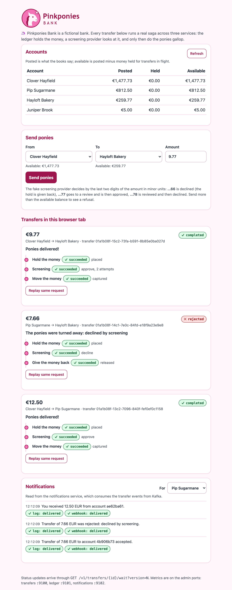
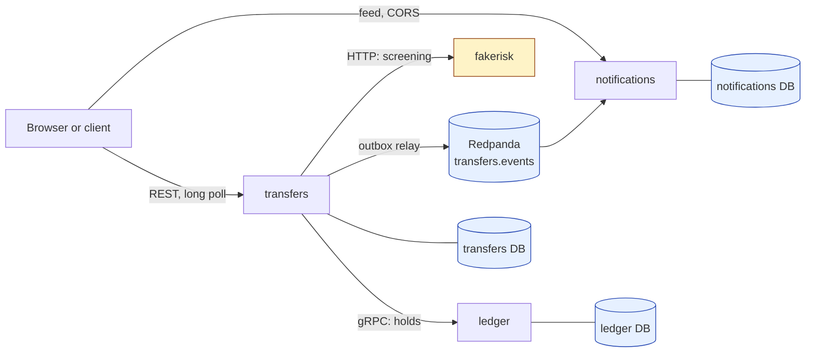

<p align="center"></p>

# pinkponies-bank

Pinkponies Bank is a fictional bank used to keep the example concrete; its
ponies may gallop off with your money only once.

This repository is a small, complete Go monorepo of three microservices
that shows the patterns a single service cannot: gRPC between services
with per-call deadlines and an explicit error contract, an orchestrated
saga with compensation, a transactional outbox to Kafka, an idempotent
Kafka consumer with a dead-letter topic, and a database per service. It
also says, with references into the code, where those patterns hurt:
[docs/REVIEW.md](docs/REVIEW.md) lists strengths and weaknesses, and
[docs/IMPROVEMENTS.md](docs/IMPROVEMENTS.md) the next steps.

It is the sibling of
[go-payments-reference](https://github.com/aleksbeloushkin-srb/go-payments-reference),
a single payment service by the same author, and reuses its conventions
and helpers: the transaction in a context (`pkg/txctx`), the PostgreSQL
task queue with `SKIP LOCKED` and leases, the outbox relay, long polling
with a shared batcher, strict configuration, the shutdown order,
Prometheus metrics with promtool-tested alerts, and `scripts/testreport`.
Both are reference projects of the learning site
[golang-interview-prep](https://aleksbeloushkin-srb.github.io/golang-interview-prep/).

## Quick start

Requirements: Docker with Compose v2. Go 1.24 or newer for the tests.

```sh
docker compose up --build
```

Then open <http://localhost:8080>, send ponies from one account to
another, and watch the saga: the hold, the screening, the capture or the
release, and the notifications that follow.

<p align="center"></p>

Or with curl:

```sh
# Accounts, read from the ledger over gRPC.
curl localhost:8080/v1/accounts

# A transfer. The Idempotency-Key makes the request safe to repeat.
curl -i -X POST localhost:8080/v1/transfers \
  -H 'Idempotency-Key: demo-1' -H 'Content-Type: application/json' \
  -d '{"source_account_id":"<id>","destination_account_id":"<id>","amount_minor":1250,"currency":"EUR"}'
# 201 {"id":"<transfer>","status":"pending","version":1,"steps":[]...}
# The same request again: 200 and the same transfer. The same key with
# another amount: 422.

# Long poll: answers as soon as the version is above N, or after 15 s with
# "modified": false.
curl 'localhost:8080/v1/transfers/<transfer>/wait?version=1'

# The notifications of an account.
curl 'localhost:8081/v1/notifications?account=<id>'
```

The fake screening provider decides by the last two digits of the amount
in minor units: `..66` is declined (the hold is released), `..77` is
reviewed and then approved, `..78` is reviewed and then declined; anything
else is approved. It also misbehaves on request:

```sh
curl -X POST 'localhost:8090/_control?faults=hang'       # screen, then never answer
curl -X POST 'localhost:8090/_control?faults=ambiguous'  # screen, then drop the connection
curl -X POST 'localhost:8090/_control?faults=429,500'    # refuse, then fail, before screening
curl -X POST 'localhost:8090/_control?latency=1s'        # answer late
curl 'localhost:8090/_control/screening?key=transfer:<transfer>:screen'   # calls for one key
curl -X POST 'localhost:8081/_sink/control?faults=500'   # the fake webhook receiver fails once
```

| Port | What |
| --- | --- |
| 8080 | transfers: REST API and the web UI |
| 8081 | notifications: REST feed, and the fake webhook receiver under `/_sink` |
| 8090 | fakerisk: the screening provider and its `/_control` |
| 50051 | ledger: gRPC |
| 9100, 9101, 9102 | admin listeners of transfers, ledger, notifications: `/metrics`, `/healthz`, `/readyz` |
| 9091 | Prometheus with the alert rules (`/alerts`) |
| 19092 | Redpanda's Kafka API, for tools on the host |

`make e2e` starts the stack, drives every scenario with curl and `jq`, checks
the ledger's books with SQL after each, and tears the stack down.

## Architecture



| Service | Role | API | Data |
| --- | --- | --- | --- |
| `ledger` | accounts and money, the source of truth for balances | gRPC [`ledger.proto`](api/proto/ledger/v1/ledger.proto) | accounts, holds, double-entry journal |
| `transfers` | client API and saga orchestrator | REST [`transfers.yaml`](api/openapi/transfers.yaml), events [`api/events/v1`](api/events/v1/events.go) | transfers, saga steps, task queue, outbox |
| `notifications` | tells clients what happened | consumes `transfers.events`; REST [`notifications.yaml`](api/openapi/notifications.yaml) | processed events, notifications, deliveries |
| `fakerisk` | stand-in for an external screening provider, not a service of the bank | `POST /screenings` | in memory |

A transfer is accepted in one transaction (the transfer, its first task and
`transfer.created`), then moved by a saga that runs as tasks on the
PostgreSQL task queue: **hold** the money in the ledger, **screen** the
transfer at the provider, then **capture** the hold, or **release** it
when the transfer cannot complete. Every step calls the remote side with
a key that is the same on every attempt, so a crash or a lost answer is
fixed by asking again. Every status change writes an event to the outbox
in the same transaction; the relay publishes it to Kafka at least once,
and the notifications service stores each event once by its id.
[docs/SAGA.md](docs/SAGA.md) has the steps, the compensation and every
crash point; [docs/ARCHITECTURE.md](docs/ARCHITECTURE.md) the contracts,
the data model and the sequence diagrams.

## How to read the code

| Step | Where | What to look for |
| --- | --- | --- |
| 1 | [`internal/ledger`](internal/ledger) | `Account`, `Hold`, `Post`: the rules of money |
| 2 | [`internal/ledger/app`](internal/ledger/app) | `PlaceHold`, `CaptureHold`, `ReleaseHold`: the lock order, the key lookup after the lock |
| 3 | [`internal/ledger/migrations`](internal/ledger/migrations/00001_init.sql) | the deferred trigger, the check constraint, the append-only journal |
| 4 | [`internal/ledger/grpcapi`](internal/ledger/grpcapi) | `errors.go`: one table from domain errors to codes and reasons; `interceptors.go`; `grpcserver.go` |
| 5 | [`internal/transfers/app`](internal/transfers/app) | `ports.go`: what the saga needs; `saga.go`: the steps; `create.go`; `query.go` |
| 6 | [`internal/transfers/ledgerclient`](internal/transfers/ledgerclient/client.go) | per-call deadlines, `AlreadyExists` back into a result, `classify` |
| 7 | [`internal/transfers/riskclient`](internal/transfers/riskclient/client.go) | what is "executed", "maybe executed" and "our fault" |
| 8 | [`internal/platform/taskqueue`](internal/platform/taskqueue) | the claim, the lease as a fencing token, continuous claiming |
| 9 | [`internal/transfers/outbox`](internal/transfers/outbox/relay.go), [`kafkapub`](internal/transfers/kafkapub/publisher.go) | lease, publish outside a transaction, stop at the first failure |
| 10 | [`internal/notifications/consumer`](internal/notifications/consumer/consumer.go) | commit after handling, poison versus transient, the dead-letter topic |
| 11 | [`internal/notifications/app`](internal/notifications/app/service.go) | deduplication by event id in the same transaction |
| 12 | `cmd/*/main.go` | composition roots and shutdown order; `config.go` next to each |
| 13 | [`internal/archtest`](internal/archtest/imports_test.go) | the import rules between services, as a test |
| 14 | [`test/integration`](test/integration) | the books under 100 concurrent transfers, crash points on PostgreSQL, the pipeline to Kafka and back |

## Where each pattern lives

| Pattern | File |
| --- | --- |
| Double entry enforced in code and by the database | [`internal/ledger/journal.go`](internal/ledger/journal.go), [`internal/ledger/migrations/00001_init.sql`](internal/ledger/migrations/00001_init.sql) |
| Holds: available = posted − active holds, never below zero | [`internal/ledger/account.go`](internal/ledger/account.go), [`internal/ledger/app/holds.go`](internal/ledger/app/holds.go) |
| Idempotent RPCs, replay as `AlreadyExists` with the original result | [`internal/ledger/app/holds.go`](internal/ledger/app/holds.go), [`internal/ledger/grpcapi/errors.go`](internal/ledger/grpcapi/errors.go) |
| Deadlock-free lock order, `FOR NO KEY UPDATE` | [`internal/ledger/postgres/store.go`](internal/ledger/postgres/store.go) |
| Hold expiry sweep with `SKIP LOCKED` | [`internal/ledger/app/expiry.go`](internal/ledger/app/expiry.go) |
| gRPC interceptors, health, graceful stop with a forced fallback | [`internal/ledger/grpcapi`](internal/ledger/grpcapi) |
| Error details in a contract enum, not in messages | [`api/proto/ledger/v1/ledger.proto`](api/proto/ledger/v1/ledger.proto) (`ErrorReason`) |
| Orchestrated saga, one key per step, compensation, a guarded pivot | [`internal/transfers/app/saga.go`](internal/transfers/app/saga.go) |
| Every crash point as a test | [`internal/transfers/app/crash_test.go`](internal/transfers/app/crash_test.go), [`test/integration/saga_test.go`](test/integration/saga_test.go) |
| Task queue: `SKIP LOCKED`, lease, fencing, backoff, dead state, postpone | [`internal/platform/taskqueue`](internal/platform/taskqueue) |
| Transactional outbox and relay | [`internal/transfers/postgres/outbox.go`](internal/transfers/postgres/outbox.go), [`internal/transfers/outbox/relay.go`](internal/transfers/outbox/relay.go) |
| Kafka producer: key per transfer, acks from all replicas, idempotence | [`internal/transfers/kafkapub/publisher.go`](internal/transfers/kafkapub/publisher.go) |
| Event contract with a golden body | [`api/events/v1`](api/events/v1) |
| Consumer group with manual commits, DLQ after N tries with backoff | [`internal/notifications/consumer/consumer.go`](internal/notifications/consumer/consumer.go) |
| Exactly-once effect: at-least-once delivery plus dedup | [`internal/notifications/app/service.go`](internal/notifications/app/service.go) |
| Consumer lag and DLQ size from the brokers | [`internal/platform/kafka/collector.go`](internal/platform/kafka/collector.go) |
| Long polling with markers and one query per tick | [`internal/transfers/longpoll`](internal/transfers/longpoll) |
| CORS for a feed read from another origin | [`internal/notifications/httpapi/httpapi.go`](internal/notifications/httpapi/httpapi.go) |
| Strict configuration with cross-checks | `cmd/*/config.go`, [`internal/platform/envconfig.go`](internal/platform/envconfig.go) |
| Goroutine owners and the shutdown order | `cmd/*/main.go`, [`internal/platform/lifecycle.go`](internal/platform/lifecycle.go), [`internal/platform/server.go`](internal/platform/server.go) |
| Service boundaries as a test | [`internal/archtest/imports_test.go`](internal/archtest/imports_test.go) |
| Alert rules with unit tests | [`deploy/prometheus/alerts.yml`](deploy/prometheus/alerts.yml), [`deploy/prometheus/alerts_test.yml`](deploy/prometheus/alerts_test.yml) |

## Tests

```sh
make test               # unit tests, -race, no Docker
make test-integration   # adds PostgreSQL and Redpanda via testcontainers (needs Docker)
make e2e                # the whole stack with docker compose, curl and jq
make lint               # gofmt, go vet with and without the integration tag, staticcheck
make proto-check        # generated gRPC code matches a fresh buf generate
make check-alerts       # promtool: Prometheus config and alert rule tests (needs Docker)
```

Unit tests use in-memory fakes with real rollback semantics, `httptest`
servers, bufconn for gRPC, the real task queue worker and injected clocks;
none of them sleeps to synchronize. They cover the ledger's invariants
over random operation sequences, every saga crash point on four paths,
ambiguous screening answers, the consumer's commit and dead-letter rules,
and the import rules. Integration tests run 100 concurrent transfers and
racing holds against PostgreSQL and check the books in SQL, repeat the
crash points against PostgreSQL and the real ledger over gRPC, and run the
pipeline from a transfer to a delivered notification through Redpanda,
publishing every event twice. Everything runs with `-race` on Go 1.24 and
the latest Go release; the critical tests also ran with `-cpu=2
-count=200` (REVIEW.md, "Verification").

If Docker runs in a VM whose socket is not the default (for example
colima), point testcontainers at it:

```sh
export DOCKER_HOST=unix://$HOME/.colima/default/docker.sock
export TESTCONTAINERS_DOCKER_SOCKET_OVERRIDE=/var/run/docker.sock
```

## Troubleshooting

**Image builds stall on a VM-based Docker (for example colima on macOS).**
Some VM setups have a bridge network that stalls large downloads, so `go
build` inside the image never finishes fetching modules. A one-off, local
workaround is to build on the host network with a Compose override file;
Compose loads `compose.override.yaml` automatically and `.gitignore`
keeps it out of commits:

```sh
cat > compose.override.yaml <<'YAML'
services:
  ledger: { build: { network: host } }
  transfers: { build: { network: host } }
  notifications: { build: { network: host } }
  fakerisk: { build: { network: host } }
YAML
docker compose up --build
```

If downloads fail even then, build the binaries on the host
(`CGO_ENABLED=0 GOOS=linux GOARCH=arm64 go build -o dist/ ./cmd/...`, with
the architecture of the VM) and point the override's `build` at a
git-ignored Dockerfile in `dist/` that copies them onto
`gcr.io/distroless/static-debian12:nonroot`. Delete the override once the
network is fixed.

## Configuration

Every setting comes from the environment and is validated at start: an
unknown variable with the service's prefix, an unparsable value or an
inconsistent combination stops the process with every problem listed. Each
default has its reason next to it in `cmd/<service>/config.go`. The ones
worth knowing:

| Variable | Default | Purpose |
| --- | --- | --- |
| `LEDGER_DATABASE_URL` | required | the ledger's database |
| `LEDGER_HOLD_DEFAULT_TTL` / `_MAX_TTL` | `15m` / `24h` | how long a hold may live |
| `LEDGER_SWEEP_INTERVAL` / `_BATCH` | `5s` / `100` | the expiry sweep |
| `LEDGER_SEED_FILE` | empty | JSON accounts to open at start, idempotently |
| `TRANSFERS_ROLES` | `api,worker,relay` | parts of the binary to run |
| `TRANSFERS_LEDGER_ADDR` / `_TIMEOUT` | required / `3s` | gRPC target, per-call deadline |
| `TRANSFERS_RISK_URL` / `_TIMEOUT` | required for the worker / `2s` | screening provider, per-call deadline |
| `TRANSFERS_RISK_MAX_RETRY_AFTER` | `30s` | the longest wait a 429 may ask for; checked: shorter than the review timeout |
| `TRANSFERS_TASK_LEASE` / `_TIMEOUT` / `_MAX_ATTEMPTS` | `45s` / `15s` / `15` | the task queue; checked: call + 5 s ≤ timeout, timeout + 10 s ≤ lease |
| `TRANSFERS_WORKER_IDLE_INTERVAL` | `500ms` | how soon delayed retries and other instances' tasks are found; as long as the first retry delay |
| `TRANSFERS_HOLD_TTL` | `30m` | hold TTL asked of the ledger; checked: covers the worst case of the hold, screen and capture steps (22 min with the defaults) |
| `TRANSFERS_SCREEN_MAX_FAILURES` / `_REVIEW_TIMEOUT` | `6` / `5m` | bounds of screening before compensation |
| `TRANSFERS_KAFKA_BROKERS` / `_TOPIC` | required for the relay / `transfers.events` | the outbox's destination |
| `TRANSFERS_WAIT_TIMEOUT` / `_MAX_WAITERS` | `15s` / `2000` | long polling |
| `TRANSFERS_HTTP_WRITE_TIMEOUT` | `30s` | twice the long-poll timeout; checked: covers the wait, its two reads and 5 s to write |
| `TRANSFERS_UI_NOTIFICATIONS_URL` | empty | the notifications API as the browser reaches it |
| `NOTIFICATIONS_KAFKA_BROKERS` / `_TOPIC` / `_DLQ_TOPIC` / `_GROUP` | required / `transfers.events` / `transfers.events.dlq` / `notifications` | what to consume, where poison goes |
| `NOTIFICATIONS_CONSUMER_MAX_ATTEMPTS` | `5` | tries of a poison message before the DLQ |
| `NOTIFICATIONS_CHANNELS` / `_WEBHOOK_URL` | `log,webhook` / required for webhook | delivery channels, each at most once |
| `NOTIFICATIONS_CORS_ORIGINS` | empty | browser origins allowed to read the feed |
| `NOTIFICATIONS_SINK_ENABLED` | `false` | the fake webhook receiver, for development |
| `FAKERISK_REVIEW_DELAY` / `_FAULTS` / `_LATENCY` | `3s` / empty / `0s` | the fake provider's behaviour |

## Dependencies

| Module | Version | Why |
| --- | --- | --- |
| `google.golang.org/grpc` | v1.80.0 | the ledger's API: deadlines, status codes with details, interceptors, health, keepalive; the newest release that supports Go 1.24 |
| `google.golang.org/protobuf` | v1.36.11 | generated messages and well-known types; matches `protoc-gen-go` v1.36.11 |
| `google.golang.org/genproto/googleapis/rpc` | (with grpc) | `errdetails.ErrorInfo` and `BadRequest` for the error contract |
| `github.com/twmb/franz-go` | v1.20.6 | Kafka client: consumer groups with manual commits and blocked rebalances, idempotent producer; v1.20 is the last line that builds with Go 1.24 |
| `github.com/twmb/franz-go/pkg/kadm` | v1.17.1 | committed and listed offsets for the lag and DLQ gauges; topic creation in tests |
| `github.com/jackc/pgx/v5` | v5.8.0 | PostgreSQL driver and pool, native types, no `database/sql` in the way |
| `github.com/pressly/goose/v3` | v3.26.0 | SQL migrations embedded per service, applied at start under an advisory lock |
| `github.com/prometheus/client_golang` | v1.23.2 | metrics on an injected registry, collectors; the newest release that builds with Go 1.24 |
| `golang.org/x/sync` | v0.19.0 | `errgroup` behind the owner of background components |
| `github.com/google/uuid` | v1.6.0 | UUIDv7 ids, index-friendly |
| `github.com/testcontainers/testcontainers-go` (+ `postgres`, `redpanda`) | v0.40.0 | real PostgreSQL and Redpanda in integration tests only |

Tools, pinned in the Makefile and installed into `./bin`: buf v1.65.0,
protoc-gen-go v1.36.11, protoc-gen-go-grpc v1.5.1, staticcheck 2025.1.1.
Everything else is the standard library: `net/http` with Go 1.22 routing,
`log/slog`, `embed`. There is no ORM, no web framework and no DI
container: each `cmd/<service>/main.go` is a hand-written composition root
that reads top to bottom.

## Documents

- [docs/ARCHITECTURE.md](docs/ARCHITECTURE.md): services, contracts, the error model, package layout, data model, sequence diagrams
- [docs/SAGA.md](docs/SAGA.md): orchestration versus choreography, the steps, compensation, every crash point and its test
- [docs/REVIEW.md](docs/REVIEW.md): strengths and weaknesses with file and line references, and what the build itself caught
- [docs/IMPROVEMENTS.md](docs/IMPROVEMENTS.md): next steps with effect, cost and risk
- [docs/OBSERVABILITY.md](docs/OBSERVABILITY.md): every metric, every alert with its PromQL and first check, log correlation
- [docs/EXTENDING.md](docs/EXTENDING.md): a new saga step, a real provider, another consumer, a channel, a ledger operation, scaling, versioning

## License

MIT, see [LICENSE](LICENSE).
