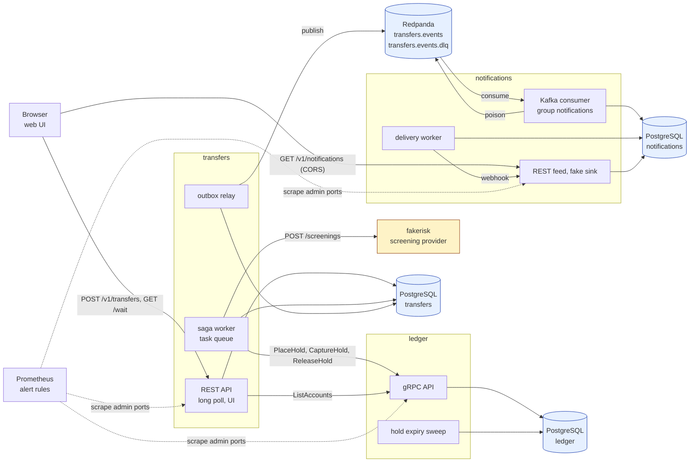
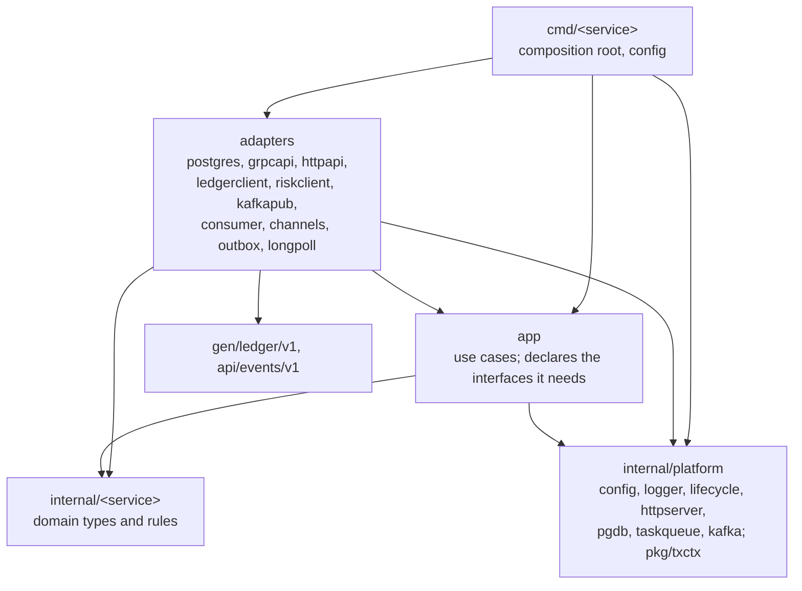
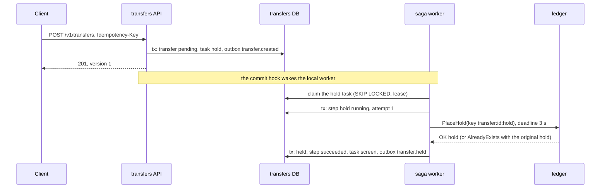
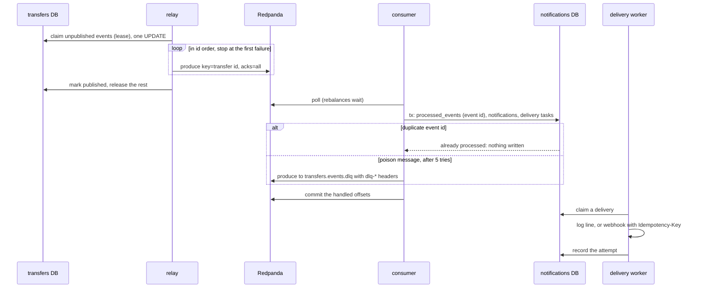

# Architecture

Three services, each with its own binary, database, configuration and
metrics, and a stand-in for an external screening provider. This document
describes how they fit together: the contracts between them, the package
layout inside each, the data model and the main flows as sequence
diagrams. The saga is described in detail in [SAGA.md](SAGA.md); the
trade-offs are in [REVIEW.md](REVIEW.md).

## Components



| Service | Role | API (contract) | Owns | Ports |
| --- | --- | --- | --- | --- |
| `ledger` | accounts and money; the source of truth for balances | gRPC [`api/proto/ledger/v1/ledger.proto`](../api/proto/ledger/v1/ledger.proto) | accounts, holds, transactions, entries | 50051 gRPC, 9101 admin |
| `transfers` | the client API and the saga orchestrator | REST [`api/openapi/transfers.yaml`](../api/openapi/transfers.yaml); publishes [`api/events/v1`](../api/events/v1/events.go) | transfers, saga steps, tasks, outbox | 8080 HTTP, 9100 admin |
| `notifications` | tells clients what happened | consumes `transfers.events`; REST [`api/openapi/notifications.yaml`](../api/openapi/notifications.yaml) | processed events, notifications, deliveries, delivery attempts, tasks | 8081 HTTP, 9102 admin |
| `fakerisk` | a stand-in for an external screening provider, with failure injection | HTTP `POST /screenings` with `Idempotency-Key` | screenings, in memory | 8090 |

The admin port of each service serves `/metrics`, `/healthz` and
`/readyz` and is meant for the cluster network only.

## Contracts

The services never import each other's code; the import rules are a test
([`internal/archtest`](../internal/archtest/imports_test.go)). They meet in
three contracts, all in this repository:

| Contract | Between | Format | Compatibility |
| --- | --- | --- | --- |
| `ledger.v1.LedgerService` | transfers to ledger | protobuf over gRPC; generated Go in `gen/ledger/v1`, committed and checked against a fresh `make proto` in CI | add fields and methods; never reuse field numbers; `buf breaking` is the tool (not wired yet, see IMPROVEMENTS.md) |
| `transfers.events` | transfers to notifications (and any future consumer) | JSON body (`eventsv1.TransferEvent`), key = transfer id, headers `event-id`, `event-type`, `content-type` | fields and event types may be added: consumers ignore unknown fields and skip an unknown type (counted as `ignored`, not dead-lettered); changing what an existing field or type means is a breaking change: a new `schema_version` and a new package |
| screening | transfers to the provider | JSON over HTTP, `Idempotency-Key` | owned by the provider; the client classifies every answer |

### The ledger's error model

Every failure is a gRPC status; business refusals carry a
`google.rpc.ErrorInfo` with a reason from the `ErrorReason` enum of the
proto, so the client never parses messages. The mapping on the server is
one table in [`internal/ledger/grpcapi/errors.go`](../internal/ledger/grpcapi/errors.go);
the mapping back on the client is one function in
[`internal/transfers/ledgerclient/client.go`](../internal/transfers/ledgerclient/client.go).

| Code | When | The saga does |
| --- | --- | --- |
| `OK` | first execution | applies the result |
| `AlreadyExists` + the original response as a detail | a replay of an idempotency key | applies the attached result, as if it were the first |
| `InvalidArgument` + `BadRequest` | a malformed field | gives up (a bug) |
| `InvalidArgument` + `IDEMPOTENCY_KEY_REUSED` | the key was used with another request | gives up (a bug) |
| `NotFound` + `ACCOUNT_NOT_FOUND` | an account does not exist | rejects the transfer |
| `FailedPrecondition` + `INSUFFICIENT_FUNDS`, `CURRENCY_MISMATCH` | the hold cannot be placed | rejects the transfer |
| `FailedPrecondition` + `HOLD_EXPIRED`, `HOLD_RELEASED` | the hold is gone | releases and cancels |
| `FailedPrecondition` + `HOLD_CAPTURED` | a release after a capture | gives up and logs an error (a bug) |
| `Unavailable`, `DeadlineExceeded`, `Aborted`, `Internal` | transient, or unknown | retries with the same key |

Every call has its own deadline from the caller's context; server-side
interceptors add the request id, an access log line, metrics and panic
recovery, in that order. The standard health service reports
`NOT_SERVING` from the moment shutdown starts.

## Inside a service

Each service follows the same layout, close to the ports-and-adapters
layout of go-payments-reference:



| Layer | Rule | Enforced by |
| --- | --- | --- |
| domain (`internal/ledger`, `internal/transfers`, `internal/notifications`) | standard library and `google/uuid` only (notifications: also the event contract) | `TestDomainsAreLeaves` |
| use cases (`.../app`) | no pgx, gRPC, franz-go, Prometheus, `net/http`, generated code or `txctx`; the interfaces they use are declared next to them | `TestUseCasesImportNoAdapters` |
| a service | never another service's packages | `TestServicesDoNotImportEachOther` |
| a binary | wires its own service only | `TestCommandsWireOnlyTheirService` |
| platform, `pkg`, contracts | no service | `TestSharedCodeKnowsNoService` |

The shared platform is plumbing only: the strict environment loader, the
logger with the request id, the owner of background goroutines, the HTTP
middleware and admin handler, the pool and migrations, the task queue and
the Kafka client helpers. `pkg/txctx` carries a transaction in a context,
as in go-payments-reference.

## Data model

Each service owns its database; in the local stack they are three
databases with three roles on one PostgreSQL server
([`deploy/postgres/init.sql`](../deploy/postgres/init.sql)).

### ledger

| Table | Key columns | Guards |
| --- | --- | --- |
| `accounts` | `posted_minor` (sum of entries), `held_minor` (sum of active holds), `kind` customer or system | `CHECK (kind = 'system' OR posted_minor - held_minor >= 0)`: no customer is ever overdrawn |
| `holds` | `account_id`, `destination_account_id`, `amount_minor`, `status` active / captured / released, `expires_at`, unique `idempotency_key` | a captured hold has a transaction, and only then |
| `transactions` | unique `idempotency_key`, unique `hold_id` | a hold is captured at most once |
| `entries` | `transaction_id`, `account_id`, signed `amount_minor`, `balance_after_minor` | a deferred constraint trigger refuses a commit in which a transaction's entries do not sum to zero; a trigger refuses any UPDATE or DELETE |

Money is moved, never created: a deposit takes it from the treasury of the
currency, whose balance is negative, so the posted balances of all
accounts always sum to zero. Rows are locked with `FOR NO KEY UPDATE` in a
fixed order (a hold before accounts, accounts by id), which keeps
concurrent captures free of deadlocks and lets foreign-key checks proceed.

### transfers

| Table | Purpose |
| --- | --- |
| `transfers` | the state machine; `version` grows with every committed change; unique `idempotency_key` with the request hash |
| `saga_steps` | one row per step and transfer: state, outcome, attempts, the step's idempotency key |
| `tasks` | the task queue (`internal/platform/taskqueue`): `FOR UPDATE SKIP LOCKED` claims, a lease that is also the fencing token, retries, dead state |
| `outbox` | events written with the change they describe; claimed with a lease by the relay |

### notifications

| Table | Purpose |
| --- | --- |
| `processed_events` | one row per consumed event id: the deduplication |
| `notifications` | one per event and account, unique `(event_id, account_id)` |
| `deliveries`, `delivery_attempts` | the state of each channel and every try |
| `tasks` | the same task queue, for deliveries |

## Flows

### Accept a transfer and hold the money



### Screen, then capture or release

```mermaid
sequenceDiagram
    participant W as saga worker
    participant DB as transfers DB
    participant R as screening provider
    participant L as ledger
    W->>DB: tx: step screen running
    W->>R: POST /screenings (key transfer:id:screen)
    alt review
        R-->>W: 202 review, Retry-After
        W->>DB: tx: step screen waiting; task postponed
        Note over W,R: polled later with the same key
    else timeout, 5xx, reset
        R--xW: no decision
        Note over W,R: retried with backoff, same key, bounded
    else approve
        R-->>W: 200 approve
        W->>DB: tx: step succeeded, task capture
        W->>DB: tx: step capture running
        W->>L: CaptureHold(key transfer:id:capture)
        L-->>W: OK transaction
        W->>DB: tx: completed, outbox transfer.completed
    else decline
        R-->>W: 200 decline
        W->>DB: tx: step succeeded, task release
        W->>L: ReleaseHold(key transfer:id:release)
        L-->>W: OK
        W->>DB: tx: rejected, outbox transfer.rejected
    end
```

### Events to notifications



### Long polling

`GET /v1/transfers/{id}/wait?version=N` registers a waiter in a
per-instance registry, reads the transfer once, and waits. One batcher
goroutine per instance reads the versions of all awaited transfers with
one query per tick (200 ms) and wakes the waiters whose transfer moved
past their marker. The answer after the soft timeout (15 s) is
`modified: false`; at shutdown, waiters are released at once. The design
is go-payments-reference's ([`internal/transfers/longpoll`](../internal/transfers/longpoll)).

### Shutdown

Each binary stops in the same order: readiness off (and for the ledger,
gRPC health `NOT_SERVING`); the worker stops claiming; a pause for load
balancers; the API drains (the ledger's gRPC server stops gracefully,
forcefully after `LEDGER_SHUTDOWN_TIMEOUT`); background components finish
what they hold (a saga step, an outbox batch, a consumed record, which is
committed); the Kafka client leaves its group; the admin listener stops;
the database pool closes. Every goroutine is started by an owner that
waits for it: `platform.Group` for background components,
`platform.Server` for HTTP servers, `grpcapi.Stop` for the gRPC server.
