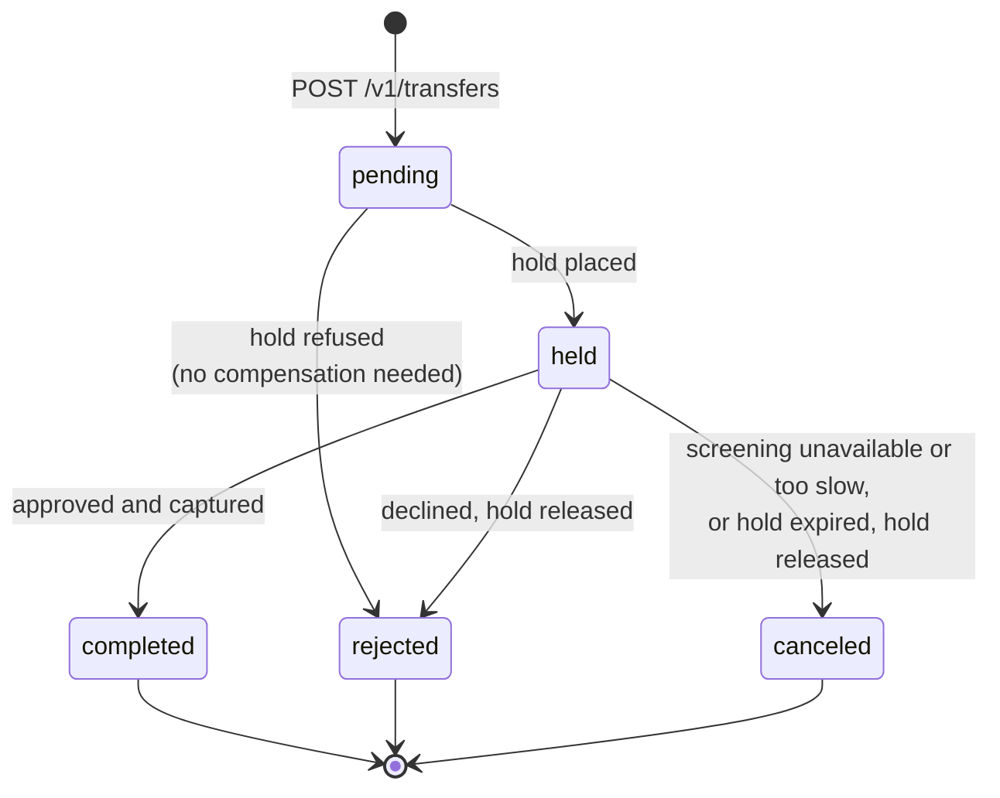

# The transfer saga

A transfer moves money between two customer accounts that live in the
ledger service, after an external screening provider has looked at it. No
single database transaction can cover that: the transfer lives in the
transfers database, the money in the ledger database, and the screening
decision at a third party. A saga replaces the one big transaction with a
sequence of local transactions, each with a known way back.

This document covers the design: why the saga is orchestrated, what each
step does, how it is undone, and what happens after a crash at every point.
The code is in [`internal/transfers/app/saga.go`](../internal/transfers/app/saga.go).

## Orchestration, not choreography

| | Orchestration (this repository) | Choreography |
| --- | --- | --- |
| Who decides the next step | the transfers service, in one function per step | each service, reacting to the previous service's event |
| Where the state of a transfer is | one row and its saga log in the transfers database | spread over the services' databases and the event history |
| Adding a step | one handler and one task kind in one service | a new event type, a new subscriber, and changes wherever the order matters |
| Compensation | decided in one place, with the whole state at hand | every service must know which events undo what |
| Coupling | transfers knows the ledger's gRPC API and the provider's HTTP API | services know only events, but implicitly depend on each other's reactions |
| Visibility | `GET /v1/transfers/{id}` shows every step | needs tracing or an event log reader |
| Failure of the coordinator | the saga pauses; the task queue resumes it | no coordinator, but a lost event stalls the chain silently |

Money is the reason for orchestration here. The pivot (moving the money)
must happen at most once and only after an approval, and a refused or
abandoned transfer must give the held money back; those rules are easier
to read, test and audit in one function than in the reactions of three
services. The price is that the transfers service depends on the APIs of
the ledger and the provider, and is the one place to scale and keep
healthy.

Events still exist: every status change is published to
`transfers.events` through the outbox, and the notifications service
reacts to them. That part is choreography, on purpose: notifications are
a side effect nobody waits for.

## The steps

| # | Step (task kind) | Remote call | Idempotency key | Success | Refusal |
| --- | --- | --- | --- | --- | --- |
| 1 | create (HTTP request) | none | the client's `Idempotency-Key` | `pending`, hold task, `transfer.created`, all in one transaction | 400 / 422, nothing stored |
| 2 | `hold` | `ledger.PlaceHold(source, destination, amount, TTL)` | `transfer:<id>:hold` | `held`, screen task, `transfer.held` | insufficient funds, unknown account, other currency: `rejected` with the reason |
| 3 | `screen` | `POST /screenings` at the provider | `transfer:<id>:screen` | approve: capture task | decline: release task, then `rejected` |
| 4 | `capture` | `ledger.CaptureHold(hold)` | `transfer:<id>:capture` | `completed`, `transfer.completed` | hold expired: release task, then `canceled` |
| 5 | `release` (compensation) | `ledger.ReleaseHold(hold, reason)` | `transfer:<id>:release` | `rejected` or `canceled` with the reason, and its event | none: a released hold is a replay; a captured one is a bug |

Every step runs as a task on the PostgreSQL task queue
([`internal/platform/taskqueue`](../internal/platform/taskqueue)) and has
the same three parts:

1. **Begin.** A short transaction locks the transfer row, checks that the
   transfer is still at this step, and records an attempt in the saga log
   (`saga_steps`: state `running`, attempts + 1). A crash after this commit
   leaves a step marked `running`: the database says a call may have
   happened.
2. **Call.** No transaction is open. The call carries the step's key,
   which is the same on every attempt, and a deadline of its own
   (`TRANSFERS_LEDGER_TIMEOUT`, `TRANSFERS_RISK_TIMEOUT`), shorter than the
   task's timeout, which is shorter than the task's lease.
3. **Finish.** A second short transaction locks the row again, checks
   again that the step is still open (a worker whose lease expired may have
   finished it meanwhile), applies the answer, bumps the version, records
   the event of a status change in the outbox, and enqueues the next step.

Because the key never changes, the remote side executes a step once no
matter how many times it is called: the ledger stores the key with the
hold or the transaction and answers a repeat with `AlreadyExists` and the
original result; the provider stores the key with the screening and
answers a repeat with the same screening.

### Retries

| Step | What is retried | Bound | After the bound |
| --- | --- | --- | --- |
| hold | `Unavailable`, `DeadlineExceeded`, `Aborted`, `Internal`..., and a run whose process died | the task's `TRANSFERS_TASK_MAX_ATTEMPTS` (15) with backoff | the task goes dead (`DeadTasks` alert); the transfer stays `pending`; if the hold was placed, it expires after `TRANSFERS_HOLD_TTL` |
| screen | every failed call: timeout, 5xx, lost connection, 429, 4xx. A 429 waits for its `Retry-After`, cut to `TRANSFERS_RISK_MAX_RETRY_AFTER` (30 s) and to the time the step has left | `TRANSFERS_SCREEN_MAX_FAILURES` (6) failed calls | compensation: release, `canceled` / `screening_unavailable` |
| screen (review) | a `review` answer is not a failure: the same task is postponed by the provider's `Retry-After`, clamped to 1 to 30 s and to the time the step has left | `TRANSFERS_SCREEN_REVIEW_TIMEOUT` (5 min) since the step's first run, whatever the answers were | compensation: release, `canceled` / `screening_review_timeout` if the provider answered review, `screening_unavailable` if it never did |
| capture | as hold | as hold | the task goes dead; the transfer stays `held`; an operator must finish it, because the money may have moved |
| release | as hold | as hold | the task goes dead; the hold expires after its TTL anyway |

The screening bound is checked before the call, from the task's failed
attempts, which the queue counts: polls of a review are postponements and
do not count. The queue counts an attempt when it claims the task, so a
run that kills its process (out of memory, a fatal runtime error) counts
as failed too, and a handler that crashes every time reaches the dead state
after `TRANSFERS_TASK_MAX_ATTEMPTS` leases instead of looping. `TRANSFERS_TASK_MAX_ATTEMPTS` must exceed
`TRANSFERS_SCREEN_MAX_FAILURES`; the configuration refuses to start
otherwise, or a failing screening would go dead instead of releasing its
hold.

### The pivot

Capture is the point of no return. Before it, every step can be undone by
releasing the hold, and the saga does so on any refusal or bound. After an
approval, the saga only goes forward: a capture is retried with the same
key until the ledger answers, and is never followed by a release. The
handlers check it twice: capture refuses to run without an approved
screening in the saga log, and release refuses to run after a capture.

The destination is fixed in the hold, when the hold is placed and the
accounts are checked. A capture can therefore only fail for technical
reasons or because the hold is gone; it cannot fail because of input
checked too late.

## Compensation

| Trigger | Compensating action | Final status | Reason |
| --- | --- | --- | --- |
| the ledger refuses the hold: no funds, unknown account, other currency | none: nothing was reserved | `rejected` | `insufficient_funds`, `account_not_found`, `currency_mismatch` |
| the provider declines | release the hold | `rejected` | `screening_declined` |
| the provider gave no decision after `SCREEN_MAX_FAILURES` calls | release the hold | `canceled` | `screening_unavailable` |
| a review lasts longer than `SCREEN_REVIEW_TIMEOUT` | release the hold | `canceled` | `screening_review_timeout` |
| the hold expired before the capture | release the hold (a replay if the ledger's sweep was first) | `canceled` | `hold_expired` |

`rejected` is the bank saying no; `canceled` is the bank unable to finish.
Both end with the money back where it was, and both are events the
notifications service tells the client about.

The ledger's expiry sweep
([`internal/ledger/app/expiry.go`](../internal/ledger/app/expiry.go)) is
the safety net under all of this: a hold whose saga never comes back is
released after its TTL. The TTL starts when the ledger places the hold, so
`TRANSFERS_HOLD_TTL` (30 min) must cover every step that runs on it: the
hold step's retries after a lost answer, the screen step (bounded by
`TRANSFERS_SCREEN_REVIEW_TIMEOUT` from its first run) and the capture's
retries, each retry taking its whole `TRANSFERS_TASK_TIMEOUT` and the
longest backoff. The configuration adds that up and refuses a shorter TTL
(22 min with the defaults), or an approved transfer could find its hold
expired. It must not exceed the ledger's
`LEDGER_HOLD_MAX_TTL` (24 h): the ledger refuses a longer TTL as an invalid
argument, and that check spans two services, so no configuration can
enforce it (see [REVIEW.md](REVIEW.md)).

## Crash points

"Crash" means the process dies at that point and a fresh process (or
another worker, after the task's lease expires) runs the task again. "Lost
answer" means the remote side executed the call and the answer never
arrived. The happy path has seven transactions and three remote calls; the
table follows them.

| # | Point | What is stored at that moment | What happens next | Outcome |
| --- | --- | --- | --- | --- |
| 1 | before the create commit | nothing | the client sees an error and retries with its `Idempotency-Key` | one transfer |
| 2 | after the create commit, before the answer | transfer `pending`, hold task, `transfer.created` | the client retries: 200 with the same transfer | one transfer |
| 3 | before or after the hold step's begin commit | at most an attempt on the hold step | the task runs again: PlaceHold with the same key | one hold |
| 4 | after PlaceHold executed, before its answer was applied (crash or lost answer) | the hold exists in the ledger; the transfer is still `pending` | the task runs again; PlaceHold answers `AlreadyExists` with the original hold | one hold, `held` |
| 5 | before the hold result commit | as 4 | as 4 | one hold, `held` |
| 6 | after the hold result commit, before the task is settled | `held`, screen task, `transfer.held` | the hold task runs again, finds the transfer past its step and completes | nothing repeated |
| 7 | before or after the screen step's begin commit | an attempt on the screen step | the screen task runs again with the same key | one screening |
| 8 | after the provider screened, before the answer was applied | the screening exists at the provider | the screen task runs again; the provider returns the same screening | one screening |
| 9 | before or after the screen result commit | approve: capture task / decline: release task | the next task runs | the decision is applied once |
| 10 | before or after the capture step's begin commit | an attempt on the capture step | the capture task runs again with the same key | one capture |
| 11 | after CaptureHold executed, before its answer was applied | the ledger moved the money; the transfer is still `held` | the capture task runs again; CaptureHold answers `AlreadyExists` with the original transaction | **one debit**, `completed` |
| 12 | before or after the capture result commit | as 11, or `completed` and `transfer.completed` | as 11, or nothing to do | one debit |
| 13 | after ReleaseHold executed, before its answer was applied (decline path) | the hold is released; the transfer is `held` | the release task runs again; ReleaseHold answers `AlreadyExists` | one release, `rejected` |
| 14 | the relay crashed after Kafka acknowledged an event, before marking it | the event is unpublished in the outbox | its lease expires and the relay publishes it again, under the same event id | a duplicate on the topic |
| 15 | the consumer crashed after storing an event, before committing the offset | the event is in `processed_events` | the record is delivered again; the consumer finds the id and commits | one set of notifications |
| 16 | the delivery worker crashed after the webhook POST, before recording it | the delivery is `pending` | the delivery runs again with the same `Idempotency-Key` | the receiver deduplicates |

Each row is a test:

| Rows | Test |
| --- | --- |
| 1 to 13, in memory, every transaction (before and after commit) and every remote call (crash and lost answer), on four paths (approve, decline, review then approve, insufficient funds): 72 cases | `TestEveryCrashPoint` in [`internal/transfers/app/crash_test.go`](../internal/transfers/app/crash_test.go) |
| 1 to 13 against PostgreSQL and the real ledger over gRPC, approve and decline paths, checked in the ledger's tables: 36 cases | `TestSagaCrashPoints` in [`test/integration/saga_test.go`](../test/integration/saga_test.go) |
| 8, with the real fake provider hanging after it executed | `TestSagaScreeningHangThenSameKeyRetry`, and the end-to-end script |
| 14 | `TestRelayRepublishesUnmarkedEvents` in [`test/integration/outbox_test.go`](../test/integration/outbox_test.go) |
| 15 | `TestConsumerOffsetNotCommittedOnFailure`, `TestConsumerDuplicateEventOneNotification` in [`test/integration/notifications_test.go`](../test/integration/notifications_test.go) |
| 14 and 15 together, end to end | `TestPipelineTransferToNotificationsDeliveredOnce`, and the end-to-end script |
| 16 | `TestDeliveryIsDoneOnce` in [`internal/notifications/app/app_test.go`](../internal/notifications/app/app_test.go); the sink counts duplicates in the end-to-end script |

After every case both suites check the same things: the final status, one
hold, exactly one capture or one release (never both), the source debited
at most once, one event per status in order, and no task left unfinished.

A crash in these tests is a panic the worker recovers, which settles the
task as a failed attempt. A process that dies in the handler settles
nothing; `TestTaskQueueCrashLoopGoesDead` in
[`test/integration/queue_test.go`](../test/integration/queue_test.go)
covers that case: the claim has counted the attempt, and after
`MaxAttempts` such runs the next claim buries the task without running it.

## Ambiguous screening answers

The screening client ([`internal/transfers/riskclient`](../internal/transfers/riskclient/client.go))
does not retry by itself. It classifies each answer, for the metrics and
the logs, and wraps every failure in `ErrScreeningUnavailable`, because the
saga's response is the same in every case: the same request with the same
key, later.

| Answer | Executed? | Class |
| --- | --- | --- |
| 429 with `Retry-After` | no | `rate_limited`; the task waits at least `Retry-After`, which the client cuts to `TRANSFERS_RISK_MAX_RETRY_AFTER` and the saga to the step's remaining time |
| connection refused before anything was written | no | `unavailable` |
| timeout, reset, 5xx, 408, 409, 425, an unreadable 2xx | maybe | `ambiguous` |
| another 4xx | our request or credentials are wrong | `misconfigured` |

The ratio of ambiguous answers is an alert (`ScreeningAmbiguousRatio`):
each one costs a retry and, past the bound, a canceled transfer.

## What the saga does not do

- **It does not recover a dead task by itself.** A step that keeps failing
  for `TASK_MAX_ATTEMPTS` goes dead and waits for an operator; a dead
  capture leaves a `held` transfer whose money may or may not have moved,
  which the operator settles by requeueing the task (the key makes that
  safe). There is no tool for it yet (IMPROVEMENTS.md).
- **It trusts the remote sides' deduplication.** If the provider forgot a
  key, a retry would screen twice; if the ledger did, a retry could debit
  twice. The ledger's keys are unique constraints in its own database; the
  provider's are its promise.
- **It does not publish step progress.** Events exist for status changes
  only; the saga log is visible through the API and the long poll.
